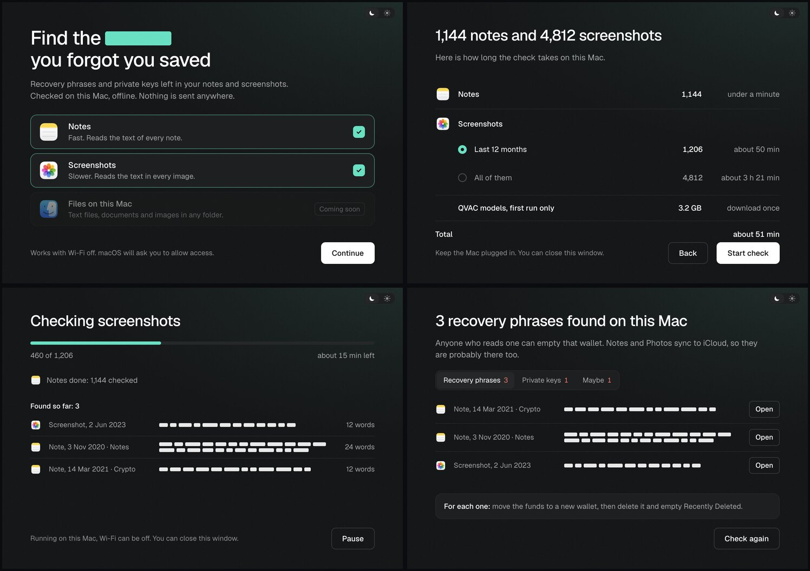

# Seed Guard

Seed Guard is a Mac app that finds crypto recovery phrases and private keys people have left in Apple Notes and in
their screenshots, and tells them where each one is so they can move the funds and delete it. Everything runs on the
Mac with the [QVAC SDK](https://docs.qvac.tether.io/sdk/js-ts-sdk): OCR and a vision model read the screenshots
locally, and the checksum decides whether a list of words is a real phrase: BIP39's, or TON's own check for 24-word
TON wallets such as Tonkeeper (same wordlist, different check). Sending a photo of your seed phrase to
a cloud AI to ask "is this exposed?" would itself expose it, which is why this only makes sense as local AI.



Open source under Apache-2.0, like the QVAC SDK it is built on. A working prototype, tested on one machine: macOS
26.6.2, Apple M2 Pro, 16 GB RAM. What comes next is in [Roadmap](#roadmap).

## Requirements

- macOS on Apple silicon (only tested on an M2 Pro; the QVAC native addons npm installs here are `darwin-arm64`).
- Node 22.18.0 (pinned in `.nvmrc`; with nvm: `nvm install && nvm use`).
- Xcode Command Line Tools (`xcode-select --install`): `swiftc` builds the Photos helper, `codesign` signs the app.
- Disk: about 2.4 GB for `node_modules` with Electron's binary, plus 3.2 GB of models downloaded once on first use
  (table below).
- RAM: the recognition process holds about 5.2–5.5 GB once one image has needed the exact pass and the vision model
  (mostly the exact pass's text detector, about 3.8 GB on a 1600 px photo), and stays there: no growth over 56 scans in a
  row. Tested with 16 GB.
- Google Chrome, only to generate the eval images (`npm run fixtures`).

## Setup

```sh
git clone https://github.com/olevasyliev/seed-guard.git && cd seed-guard
nvm install && nvm use      # Node 22.18.0
npm ci
npm run app                 # builds ~/Applications/Seed Guard.app and opens it
```

`npm run app` compiles the Photos helper (`npm run helper`) if it is missing, downloads Electron's binary if it is
missing (Electron 44 no longer does that on install), wraps Electron into
`~/Applications/Seed Guard.app` with Seed Guard's own name and usage strings, signs it ad hoc and opens it. The bundle
loads `src/` from this folder, so code changes need no rebuild; rebuild only after changing `scripts/make-app.sh`.
The app folder must not be inside iCloud Drive: iCloud adds file attributes that break the signature.

Run it through the bundle, not `npm start`: macOS attributes the Notes and Photos prompts to whichever app launches
the process, so `npm start` would ask in your terminal's name.

### First run

1. Pick Notes, Screenshots, or both, and press Continue.
2. macOS asks for access (see Permissions). The next screen shows how many notes and screenshots there are and how
   long the check will take. If the models are not on the Mac yet, it adds a row "QVAC models, first run only, 3.2 GB".
3. Start check. Notes go first (no model needed). Before the screenshots, the window shows **Preparing models** with
   the bytes downloaded and which model is coming down. This happens once; later runs skip it.
4. Results list each phrase or key by place and date, never by content. Open shows the note in Notes or the
   screenshot in Photos.

## Permissions

| Prompt | When | Why |
|---|---|---|
| "Seed Guard wants to control Notes" (Automation) | You pick Notes | Note text is read through the Notes app with JavaScript for Automation |
| Photos access | You pick Screenshots | The helper reads the Screenshots album through PhotoKit. "Limited" access works too |

If a prompt was denied, re-allow it in System Settings, Privacy & Security, Automation or Photos.

## QVAC integration

SDK: `@qvac/sdk` **0.22.0** (exact pin in `package.json`). All calls are in `src/engine/worker.mjs`, which runs in its
own process so the window stays responsive.

| Capability | SDK calls | Model (catalog constant) | Download | Role |
|---|---|---|---|---|
| OCR, fast pass | `loadModel`, `ocr` | `OCR_DOCTR` + detector `OCR_DOCTR_1` (DocTR: CRNN MobileNetV3 small, DBNet MobileNetV3 large) | 12.6 MB | Every image. Decides if it is worth a closer look |
| OCR, exact pass | `loadModel`, `ocr` | `OCR_LATIN` + detector `OCR_CRAFT` (EasyOCR Latin g2, CRAFT) | 98.5 MB | Only images the fast pass finds suspicious |
| Vision LLM, image to JSON | `loadModel`, `completion` with an image attachment and a `json_schema` response format | `QWEN3_5_4B_MULTIMODAL_Q4_K_M` + `MMPROJ_QWEN3_5_4B_MULTIMODAL_Q8_0` | 3,107.8 MB | Only near misses: twelve-plus wordlist words that fail the checksum, usually handwriting, a dark screen or a tilted photo of a screen. It returns each word with its number; the numbers give the order |
| Model cache | `getModelInfo`, `downloadAsset` with `onProgress` | all of the above | 3,218.9 MB total | One-time download with progress before the first screenshot |

The model only reads; it never decides. Every phrase it returns is checked against the checksum
(`src/engine/detect.mjs`), and only a valid checksum counts as a recovery phrase. Notes are plain text and need no
model at all: the same detector runs on them directly.

Pipeline for one screenshot: fast OCR → if there is a run of wordlist words, a numbered list, a long hex string or a
telling word ("seed", "wallet"…) → exact OCR → if either pass found a near miss → the vision model reads the list as
JSON → checksum.

## Eval

```sh
npm run fixtures   # draws 14 phone-sized screenshots with freshly generated, never-funded secrets
npm run eval       # runs the same worker the app uses and scores it against eval/fixtures/truth.json
npm run eval -- <folder>    # any folder of images with its own truth.json
```

The set: 6 recovery phrases (12- and 24-word wallet screens light and dark, a MetaMask-style grid, a Notes-app
screenshot, two handwritten lists on paper, one tilted), 1 private key, 1 broken phrase that must come back as "maybe",
and 6 look-alikes that must stay quiet (a transaction receipt with a 64-hex hash, a chat, a settings list, a shopping
list, a numbered to-do list, an article about seed phrases). Each run of `npm run fixtures` generates new random phrases
and keys.

The numbered to-do list came from a real library: its items start with wordlist words, and the app showed it as
"maybe". Eight numbered items are now enough to ask the vision model, but a "maybe" stays only if the model reads a
list of twelve or more items that are nearly all wordlist words.

Results on 22.10.2026, M2 Pro: **14/14 correct, 8/8 secrets found, 0 false alarms** on two freshly generated sets
(earlier the same day: 13/13 on the first 13 cases, three runs). A fresh set first missed its private key: exact OCR
read some 1s as "l" and a 5 as "S". Look-alike letters are now read as digits inside a line that is nearly all hex.
Per image, from the earlier runs (the later ones shared the Mac with a long check): fast pass
2.4–4.0 s, exact pass 9.6–17.2 s, vision fallback 21.9–31.3 s. The dark 12-word wallet screen needed the vision model:
OCR alone missed it. If the models are not cached, `npm run eval` downloads them first and prints the progress.

Real images, 22.10.2026: 28 iPhone screenshots and photos of a phone screen, 8 of them showing fresh, never-funded
wallets' phrases (MetaMask, a TON wallet, others) and 20 without. This set is not in the repository: the 20 everyday
images are a real person's phone. First run: 5/8 found, 20/20 quiet. The three misses and their fixes: a 24-word TON
phrase fails the BIP39 checksum by design (TON check added); "Write down these 24 words" above the list took slot 24
("N words" is now a caption, not a slot); on a tilted photo the vision model read the grid row by row (it now returns
each word with its number); on a photo of 12 plain words the exact pass read worse than the fast one and the near miss
was dropped (a near miss from either pass now goes to vision). After: **8/8 found, 20/20 quiet**, and the eval above
still 14/14. Re-run on the same files, 23.10.2026: **28/28 correct, 8/8 found, 0 false alarms**; the last pass per
image was the fast one for 17, the exact one for 9 and vision for 2.

## Real, mocked, limited

Nothing in the core flow is mocked: access, reading, local inference, checksum and results are all real.

Limits of this prototype:
- English only: the English BIP39 wordlist and English OCR.
- Private keys are a pattern (64 hex characters). A transaction hash looks the same; context words ("tx", "hash",
  "etherscan") suppress some, the rest are listed with a hint to check.
- Notes: typed text only. Images attached inside notes are not read. Notes the Notes app fails to return are
  skipped and counted.
- Files elsewhere on the Mac (text files, documents, images in folders) are not checked yet; the start screen
  shows them as "coming soon".
- Photos: only the Screenshots album. A phone photo of a paper backup in the camera roll is not checked (demo mode
  reads a folder of test images instead, see below).
- iCloud: a screenshot whose full-size image is kept only in iCloud ("Optimize Mac Storage") is read only if Photos
  hands it over. On the author's Mac (22.10) a real check read 441 of 2,941 screenshots from the last 12 months; for
  the rest PhotoKit returned no image even with network access allowed (CloudPhotoLibraryErrorDomain 1005, at once).
  Those screenshots are counted and named as not checked, never as checked. `SEED_GUARD_TEST=photos` (with
  `SEED_GUARD_PROBE_ONLY=1`) prints, through the app's own Photos access, how many are on the Mac and whether a few
  iCloud-only ones download. Counts only.
- Speed: about 2.5–4 s per clean screenshot on an M2 Pro; on a real library about 7 s on average, because about a
  third of real screenshots go to the exact pass (142 of 441, and 18 of 59 in a second run). A large library takes hours. The first estimate assumes
  2.5 s per screenshot and then switches to the measured average. Pause and close-the-window are supported; the Mac
  does not idle-sleep during a check, and when a check that took over a minute ends with the window not in front, a
  macOS notification gives the counts (never the secret).
- Ad-hoc signed, not notarized, and it runs from the source folder.
- Offline: inference needs no network once the models are cached, but a full run with Wi-Fi off has not been
  recorded for this build yet.

## Privacy design

- Note text goes from the Notes app to memory through `osascript` stdout and is never written to disk.
- Screenshots are exported one at a time as a downscaled JPEG into a private temp folder (mode 700) and deleted right
  after OCR; the folder is removed at the end.
- The OCR worker answers with kinds and word counts only, never the recognised text.
- The main process keeps kind, certainty, word count, place and date. The window (context isolation, sandbox) gets only
  that; the grey bars standing for the words are decorative.
- Apart from Electron's own caches, Seed Guard writes two small files in `~/Library/Application Support/Seed Guard/`:
  `last-run.json`, a counts-only summary of the last run used to tune the time estimate, and `settings.json`, the
  light or dark theme.
- Network: the one-time model download through the QVAC model registry. Seed Guard makes no other network calls of
  its own.

## Demo mode

For recordings, `SEED_GUARD_DEMO=1` limits Seed Guard to a Notes folder named **Seed Guard Demo**, and reads
screenshots from a plain folder instead of Photos: by default the generated eval set in `eval/fixtures` (run
`npm run fixtures` first), or any folder in `SEED_GUARD_DEMO_IMAGES`. A folder, because Photos keeps many originals only in iCloud (see "Real, mocked, limited"), and a
demo must not depend on what this Mac has kept. Each image goes through the same conversion as the eval. "Open" on a
demo image opens the file in Preview. The screens look exactly the same.

```sh
osascript -e 'quit app "Seed Guard"'   # open would otherwise just bring the running copy forward
open --env SEED_GUARD_DEMO=1 "$HOME/Applications/Seed Guard.app"
```

Quick check of the demo folder without the window (counts only, no text):

```sh
open -W -n --env SEED_GUARD_TEST=notes --env SEED_GUARD_DEMO=1 --stdout /tmp/seed-guard-test.txt "$HOME/Applications/Seed Guard.app"
cat /tmp/seed-guard-test.txt
```

## Layout

```
src/main.mjs            window, macOS access, scan pipeline
src/engine/worker.mjs   QVAC models: download, OCR passes, vision fallback
src/engine/detect.mjs   BIP39 and private-key detection (no model)
src/sources/            Notes (JXA), Photos (PhotoKit helper), demo scope
src/notes/notes.jxa.js  Notes reader
helper/photos-helper.swift  PhotoKit helper
src/ui/                 the window
eval/                   fixture generator and scorer
scripts/                helper build, app bundle
```

`SEED_GUARD_SHOTS=<dir> npx electron .` renders every screen with made-up data into PNGs, once dark and once light (`dark-start.png`, `light-start.png`, ...), and quits (no macOS prompts). `node scripts/check-colors.mjs` checks that every colour in the window comes from a theme token.

## Roadmap

1. **Release.** Move to the current QVAC SDK (0.23), ship a signed and notarized download so nobody has to build
   from source, record a full run with Wi-Fi off, and write up the OCR-then-vision pipeline as a QVAC how-to: two OCR
   passes, a vision model asked for JSON through a schema, and plain code that has the last word.
2. **Coverage.** Files anywhere on the Mac (text, Markdown, RTF, PDF, Word, images in folders), the whole photo library
   rather than only Screenshots (a phone photo of a paper backup is the classic case), images attached inside notes,
   and the BIP39 wordlists of other Latin-script languages (Spanish, French, Italian, Portuguese, Czech).
3. **Is it funded, and move it.** For every phrase found, derive its first addresses with
   [WDK](https://github.com/tetherto/wdk) (Bitcoin, EVM chains, TON, Tron, Solana) and read the native and USDT
   balances, opt-in and showing exactly what leaves the Mac: public addresses only, never the phrase. Phrases that
   hold money go to the top. Then, with WDK, create a fresh wallet on the Mac and move the funds there, each transfer
   shown with its fee and confirmed by the user.

## License

Apache-2.0, see [LICENSE](LICENSE). The Geist font in `src/ui/assets/` is under the SIL Open Font License 1.1, see
[Geist-OFL.txt](src/ui/assets/Geist-OFL.txt).
